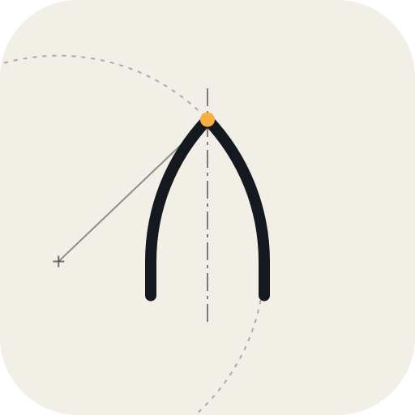
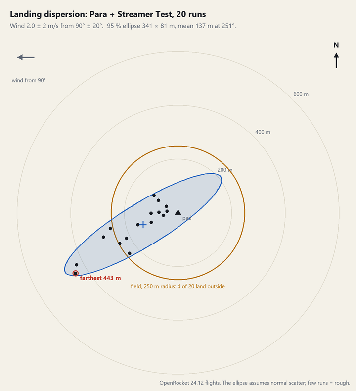

  <picture>
    <source media="(prefers-color-scheme: dark)" srcset="assets/logo.svg">
    
  </picture>

<h1 align="center">Ogive</h1>

AI tools for OpenRocket that show their working.

A thrust curve can lie. OpenRocket 24.12 ships a curve labelled Cesaroni 229H255 that is really the 315H255's
data. Same name in the dropdown, 38 % more impulse. The sim runs fine. The numbers are wrong, and so is every
design decision you tune around them.

I found that one the hard way: the predicted speed broke the rocket equation. ThrustCurve fixed their copy the
same day I reported it. OpenRocket 24.12 still ships it, so if you fly a 229H255, check which curve you've got.
Full story: [the 229H255 case study](docs/case-study-229H255.md).

So I built Ogive.

## What it is

A set of tools that let an AI work on an OpenRocket design and show its working.

You talk to Claude (or any MCP client). Ogive reads and edits your `.ork`, flies it in your own copy of
OpenRocket, and checks the flight against 14 rules. One of them catches the bad-curve problem above: integrate
the thrust curve and compare it with the motor's name.

Every number comes back with a receipt: which backend made it, which wind seed, and the sha256 of the exact file.
Edits always go to a new file. It never touches your original.

Here it is trying to make a rocket faster: [demo transcript](docs/demo-transcript.md). It tried more fin sweep,
flew both versions, found +0.007 Mach and a stability drop below the goal, and said not to bother.
That's the whole idea.

It also answers the question the RSO asks: where will it come down? Twenty real OpenRocket flights of my rocket,
each in a slightly different wind, against a field 500 m across. Four land outside it.

  

It doesn't sign off on flights. OpenRocket, RASAero II, your club and your RSO do that.

## Tested

- Installs in Claude Desktop from the `.mcpb` bundle on Windows.
- `inspect_design`, `edit_design` and `judge_design` used for real from a Claude Desktop chat.
- The 3D viewer (`view_design`) renders inside a Claude Desktop chat. `view_versions` and `replay_flight` are
  tested in a headless browser that plays Claude Desktop's part (same frame width, same messages), not yet
  screenshotted in the app itself.
- On the reference design, the judge's numbers match OpenRocket 24.12 exactly. OpenRocket does the flying; Ogive
  only reads the result, and the tests pin it.
- Runs on Linux and macOS: on every push, CI downloads the released OpenRocket 24.12 jar (hash checked), runs it
  on Java 17 on both, and passes every OpenRocket test there, the judge's exact numbers included.
- 263 automated tests, run on every push with Python 3.11 and 3.14.

## An example

I had a model with a guessed tube length. I found the real length, had Ogive edit it, then built best and worst
case variants for a wall thickness I didn't know yet. The judge passed one and failed the other on ground-hit
speed. Now I know what to measure before I trust either.

## What it can't do yet

- Claude Desktop on a Mac, and OpenRocket's macOS and Linux installers: not tried yet. The jar route is (see Tested).
- Needs OpenRocket 24.12. I haven't tried other versions.
- The flutter check is a rough screen for a flat plate. It assumes a fin shear modulus of 3 GPa, on the safe side,
  until you give it a real one from a datasheet or a test.
- Above Mach 1, OpenRocket's aerodynamics are approximate. Ogive warns you; cross-check in RASAero II.
- Landing dispersion scatters the wind only. Rod angle, motor and drag aren't varied yet, and the 95 %
  ellipse is rough with 20 flights; trust the farthest flight more.
- It can change numbers, add masses and swap motors. It can't add other parts yet.
- The optimizer only sweeps fin height and nose weight.
- The first call takes about 10 s while Java starts. Then about 1 s each.

If it breaks on your rocket, [open an issue](https://github.com/michaelsheffernan/ogive/issues), with the `.ork` if you can share it.
Found a security problem? See [SECURITY.md](SECURITY.md).

## Setup

You need [OpenRocket 24.12](https://openrocket.info/). Ogive uses OpenRocket's own engine.

- **Windows**: install OpenRocket the usual way. Ogive finds it in `C:\Program Files\OpenRocket` and uses the
  Java that comes with it.
- **macOS and Linux**: the simplest route is the plain
  [`OpenRocket-24.12.jar`](https://github.com/openrocket/openrocket/releases/tag/release-24.12) plus Java 17 or
  newer (for example [Temurin 17](https://adoptium.net/)). Point `OPENROCKET_HOME` at the jar; Ogive runs it on
  the Java in `JAVA_HOME`, or your default Java. If you used the installer instead, Ogive looks in
  `/Applications/OpenRocket.app` (macOS) and `~/OpenRocket` or `/opt/OpenRocket` (Linux) and uses the Java
  inside it.

`OPENROCKET_HOME` can be an OpenRocket folder or the jar itself. Ogive refuses Java older than 17 and says why.

**Claude Desktop:** download the `.mcpb` from the [latest release](https://github.com/michaelsheffernan/ogive/releases/latest)
(or build it with `.\tasks.ps1 mcpb`, needs Node.js), open it with Claude Desktop, and pick your rockets folder.
Ogive only reads and writes inside it, and relative paths mean that folder. The first launch takes a minute or so
while it installs Python packages.

**Claude Code** (needs Python 3.11+ and git). On Windows:

    git clone https://github.com/michaelsheffernan/ogive
    cd ogive
    .\tasks.ps1 setup

Run `claude` in that folder and approve the `ogive` server. To use it from anywhere:

    claude mcp add --scope user ogive -- C:\path\to\ogive\.venv\Scripts\python.exe -m ogive.server

On macOS or Linux:

    git clone https://github.com/michaelsheffernan/ogive
    cd ogive
    python3 -m venv .venv
    .venv/bin/python -m pip install -e ".[dev,openrocket,mcp]"
    claude mcp add ogive -e OPENROCKET_HOME=$HOME/OpenRocket-24.12.jar -- "$PWD/.venv/bin/python" -m ogive.server

(The repo's `.mcp.json` points at the Windows path; the `claude mcp add` above takes its place for you.)

Add `-e OPENROCKET_HOME=...` if OpenRocket isn't where Ogive looks, and `-e OGIVE_ROOT=C:\Rockets` (or
`~/Rockets`) to keep Ogive inside one folder.

If PowerShell won't run the scripts: `Set-ExecutionPolicy -Scope CurrentUser RemoteSigned`.

## Troubleshooting

**The first install in Claude Desktop times out.** It downloads a few Python packages, and the biggest
(`pydantic-core`) can hit uv's default 30 s timeout on a slow connection. Retry. If it keeps failing, run

    setx UV_HTTP_TIMEOUT 300

then quit Claude Desktop completely (not just the window) and open it again. The 0.1.1 bundle sets this timeout
itself, so you should only need it with older bundles.

**"No OpenRocket install"**: the message lists where Ogive looked. Point it at the OpenRocket folder in the
bundle's settings (Claude Desktop), or set `OPENROCKET_HOME` to the folder or the jar (Claude Code).

**"OpenRocket needs Java 17 or newer"**: the jar ran on an older Java. Install Java 17+ and set `JAVA_HOME` to it.

**Flying the wrong sim**: when you don't name a simulation, Ogive flies the design's first one. If your
designs carry a standard sim (same name in every file), put its name in the bundle's "Reference simulation"
setting, or set `OGIVE_SIMULATION`. Files without it still fly their first, and every result names the sim.

**The 3D view says it can't draw something**: it then shows the numbers and the side view instead. Each
Ogive build serves its viewer under a new address, so this shouldn't happen; if it does, restart the host.

## Things to try

- "Judge `my_rocket.ork` on its first sim. What fails, and what's assumed?"
- "Make it faster without failing the judge. One change at a time, prove each one."
- "Sweep fin height 28 to 40 mm and nose weight 0 to 20 g. Lightest design that passes?"
- "Where does it land if the wind is off by 3 m/s and 30 degrees? Our field is 500 m across."

## The tools

- `inspect_design`: every part and every number you can edit, plus motors and stored sims.
- `run_simulation`: fly a sim. Same file and seed, same flight. Give it a wind speed and direction to ask
  what if.
- `static_stability`: CG, CP and calibers, same as OpenRocket's design view.
- `judge_design`: fly it and run the 14 rules. Every verdict says where its number came from.
- `edit_design`: change numbers, save a new file.
- `render_design`: a to-scale side view from OpenRocket's model, with CG, CP, masses and anything marked
  ASSUMED hatched. `edit_design` and `judge_design` attach it too.
- `view_design`: the same model in 3D, inside the chat, in hosts that show MCP Apps. Rotate, zoom, explode
  the internals, colour parts by mass. Other hosts get the side view.
- `view_versions`: step through versions of a design on a timeline. The previous (or first) version is a
  ghost, changed parts are highlighted, and a table shows what moved: apogee, Mach, stability, CG, CP, mass,
  PASS/FAIL. Every version flies the same sim and seed.
- `replay_flight`: replay a simulated flight in 3D, like a video. It plays on its own; a caption says what's
  happening (Motor burning, SUPERSONIC, Coasting, Apogee, Under chute, Landed) and the timeline jumps to
  each event. Chase camera, with overview, fin, nose and ground-tracker views in a menu. It's a replay of
  OpenRocket's numbers, not footage, and it says so on screen.
- `set_motor`: swap the motor by designation. The curve is picked by its real impulse, not just its name.
- `add_mass_component`: nose weight or ballast, new file.
- `compare_designs`: diff two designs, fly both on the same sim and seed, show what changed.
- `optimize_fins_and_nose_weight`: try a grid of fin heights and nose weights, judge every one.
- `landing_dispersion`: where it lands when the wind isn't what the sim says. Flies the sim 20 times (or up
  to 200), each with its own turbulence seed and the wind scattered around the stored wind (speed and
  direction). Returns a to-scale map with every landing, the 95 % ellipse and the farthest flight, plus how
  many land outside your field if you give its radius. About 1 s per flight. Same call, same flights.

The rules: stability at Mach 0.3 and all the way up, rod exit speed, fin flutter, ground hit speed, recovery
warnings, thrust curve vs its name, stale stored results, stored burn time vs the motor, the rocket-equation
ceiling, masses adding up, mass-override traps, length-to-diameter, and a warning above Mach 1.
Thresholds live in [`rules.toml`](src/ogive/judge/rules.toml). Change them for your team.

## Command line

No AI needed for this part. Activate the venv first (`.venv\Scripts\Activate.ps1`).

    ogive tree my_rocket.ork
    ogive sim my_rocket.ork --sim "Simulation 1" --seed 42 --csv out\flight.csv
    ogive judge my_rocket.ork --sim "Simulation 1"
    ogive optimize my_rocket.ork --sim "Simulation 1" --fins 30:45:1 --nose 0:30:5
    ogive landing my_rocket.ork --sim "Simulation 1" --runs 50 --wind-sd 3 --field 250
    ogive set my_rocket.ork --component "Trapezoidal Fin Set" --field height --value 0.030 -o out\fin30.ork

`judge` exits with 1 if anything fails, so it works in scripts. `--seed` pins the wind. OpenRocket 24.12 doesn't
pass its own seed to the wind model; Ogive patches around that. The optimizer guesses where nose weight sits
(100 mm behind the tip); move it with `--nose-at`.

## Hacking on it

    .\tasks.ps1 check    # lint + all tests
    .\tasks.ps1 mcpb     # build the Claude Desktop bundle

Tests marked `openrocket` run against real OpenRocket and skip if it isn't installed.
Code is in `src/ogive/`: `ork_io` (files), `sim` (OpenRocket via JPype), `physics`, `judge`, `opt`, `server` (MCP).

[CHANGELOG.md](CHANGELOG.md) is what changed.

## Licence

GPL-3.0-or-later. Ogive runs inside OpenRocket's process, and OpenRocket is GPL, so this is too.
Details: [LICENSING.md](docs/LICENSING.md). Not affiliated with OpenRocket.

## Thanks

- [OpenRocket](https://openrocket.info/), which does the real work.
- [TheCheng2005/OpenRocket_MCP](https://github.com/TheCheng2005/OpenRocket_MCP), for the corrected flutter
  formula and its tests.
- [ThrustCurve.org](https://www.thrustcurve.org/), for the data that let me find the bad curve, and for the fast reply.
